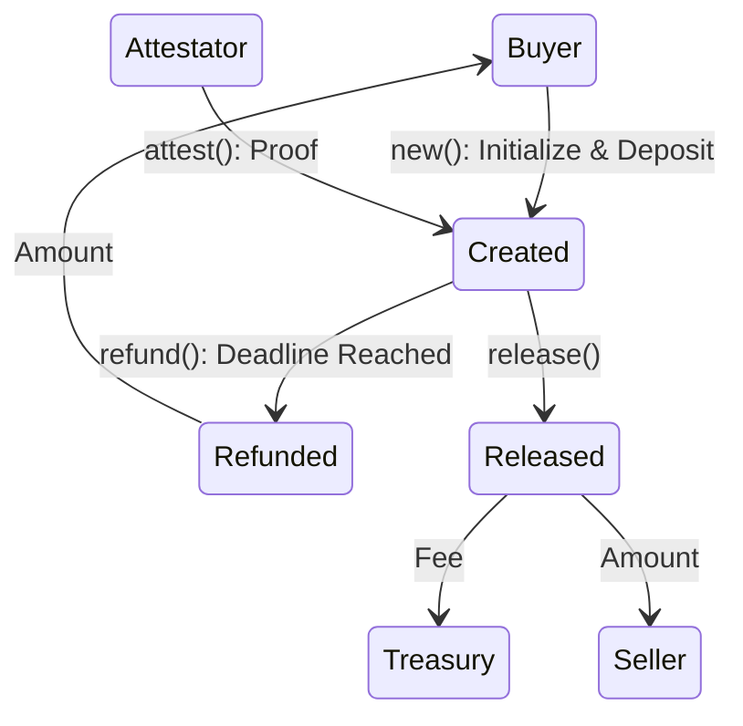

# A minimal, deterministic Anchor escrow substrate

> This repository represents the foundational substrate of an on-chain escrow: PDA-owned vaults, state lifecycle transitions, and deterministic timeout refunds.

## Hermetic Development

> This repository uses Nix flakes to guarantee deterministic, hermetic builds across development environments without relying on globally installed Rust or Anchor toolchains.

### Prerequisites

Ensure you have [Nix](https://nixos.org/download/) installed with flakes enabled.

```bash
experimental-features = nix-command flakes
```

### Quick Start

```bash
cd limbo

nix develop

code .

anchor build

nix flake check

cargo test --package limbo
```
## Architecture

### State Transition Lifecycle



### Account Derivation

Custody of assets is isolated within PDAs. No external keypair or admin key holds withdrawal authority.

### Non-Custodial Invariants

- There is no owner, admin, or emergency drain function anywhere in the contract.
- Strict guards against double settlement.
- Funds locked can be returned to the buyer via `refund()` only when `clock.unix_timestamp > deadline`.

## License

MIT or Apache-2.0
